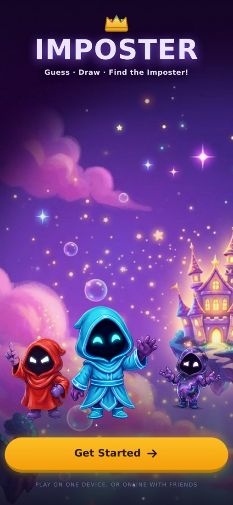
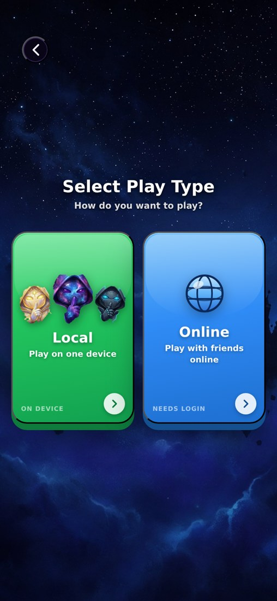
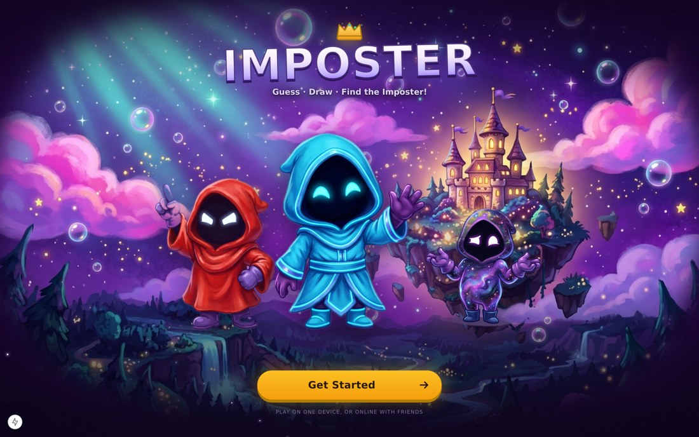

# Imposter

A multiplayer social-deduction party game for **Android** and the **web**.

Everyone gets the same secret word — except the imposter, who gets a different one. Give clues, draw, argue, then vote. The crew wins if they eject an imposter. The imposter wins by surviving.

**Plays two ways:**

- **Local** — one phone passed around the table. No internet, no account, no server.
- **Online** — everyone on their own phone or browser, in a room joined by a 6-character code.

---

## Contents

- [Screens](#screens)
- [How a game works](#how-a-game-works)
- [The two modes](#the-two-modes)
- [Playing locally](#playing-locally)
- [Playing online](#playing-online)
- [Drawing](#drawing)
- [Project layout](#project-layout)
- [Running it locally](#running-it-locally)
- [Building the Android app](#building-the-android-app)
- [Deployment](#deployment)
- [Known limits](#known-limits)
- [Troubleshooting](#troubleshooting)

---

## Screens

| Start | Choose play type | Choose game mode |
|---|---|---|
|  |  |  |

| Your card | The imposter's card | Discussion |
|---|---|---|
|  |  |  |

| Room lobby | Shared drawing board | Result |
|---|---|---|
|  |  |  |

Desktop web:



---

## How a game works

Every round runs through the same six phases:

| Phase | What happens |
|---|---|
| **lobby** | Players join, the host adjusts settings |
| **reveal** | Each player privately sees their card and role |
| **clues** | In turn, each player gives a clue — one word, two words, or a drawing |
| **discussion** | Everyone argues about who is faking |
| **voting** | Each player votes; a tie means nobody is ejected |
| **result** | Ejected player, their role, the word, scores |

Scoring is one point per round: the crew score if an imposter is ejected, the imposters score if one survives. **No votes at all is nobody's win** — not a free imposter point.

Rules the code enforces:

- **At least 3 players.** Local allows up to **12**, online rooms up to **10**
- **Imposters** scale with the table — never more than a third of it, minimum 1, maximum 3
- **Nobody can chat while clues are still being given** — the server refuses with *"Chat is closed until everyone has clued."* This is deliberate: chatting during clues leaks the word.
- **A tie ejects nobody.** No coin flips, no silent winner.

---

## The two modes

### Word
Players receive a word from one of six categories. The imposter receives a **different, related** word — close enough to bluff with, different enough to trip them up.

| Category | Pairs |
|---|---|
| Food | 229 |
| Animals | 239 |
| Places | 295 |
| Movies | 274 |
| Objects | 278 |
| Sports | 300 |
| **Total** | **1 615** |

Each entry carries a hint that describes the *group* without naming the answer. `Any` picks a category at random each round. The dealer never repeats the previous word.

### Drawing
Instead of a word, players get a **shared board**. Everyone adds to the same picture, one stroke at a time, passing the device (local) or taking their turn (online). You are drawing blind at a prompt nobody else can see — which is exactly why it produces arguments.

Drawing runs one lap per round, so **Round 2 of 3** means the board has been around the table twice.

---

## Playing locally

One device, passed around. **No server involved at all** — the whole game runs on the phone.

1. **Get Started** → **Play on one device**
2. **Word** or **Drawing**
3. Set the table on the **Table** tab — player count, imposters, and optionally **names**
4. Set the round structure on the **Round** tab
5. **Start game**

Then it walks the table:

- *"Pass the device to Ann"* — Ann taps **Tap to see your card**
- Ann reads her card, taps **Pass to Ann's neighbour**
- Repeat until everyone has seen a card
- Clue round, discussion, vote, result
- **Play again** re-deals everything with a fresh word

**Names are optional.** Leave the boxes empty and seats show as `P1`, `P2`, `P3`. Type a name and it appears everywhere: the pass screen, the clue order, the result.

---

## Playing online

### Hosting

1. **Get Started** → **Play with friends**
2. **Create room** — pick mode, seats, imposters, category
3. Share the **6-character code** (e.g. `2WCP3L`) — uppercase letters and digits, checked for collisions

### Joining

**Join room** → type the code → pick a name and avatar. The room fills up live; everyone sees the lobby change as players arrive.

### During a game

- The **host starts** the round once everyone is seated
- Cards are private — each player sees only their own
- Turns are enforced by the server: it is not your turn, you cannot draw
- The host can **kick**, **transfer host**, or change settings mid-lobby
- If you lose connection, rejoin with the same code and you resume your seat

Rooms live in server memory. **Nothing is stored**, so a server restart ends every open room. There are no accounts and no database.

---

## Drawing

Available in both local and online drawing mode.

- **12 colours** and **3 brush sizes**
- **Eraser** — paints the board background, so it erases without touching anyone else's colour
- **Undo** — removes your last stroke
- **Clear** — local only, wipes your own board
- **Fill** — the paint bucket (below)
- **Expand** — full screen, palette floating over the artwork

### Fill

Tap **◧**, pick a colour, tap inside a closed shape. The fill lands **under** your lines so it never covers an outline, and it can be undone like any stroke.

Two things worth knowing:

- **Gaps close themselves.** A finger rarely finishes where it started, so an outline that ends within about 2% of its start is treated as closed. Without this the colour escapes and floods the board — correct maths, but it looks broken.
- **A genuinely open shape still leaks.** That is how flood fill works everywhere. Draw the shape closed.

On the web this is a real canvas flood fill (`apps/mobile` has no canvas, see [Known limits](#known-limits)). Every client computes the fill from the same seed point, so a fill drawn on a phone appears identically on the web.

---

## Project layout

```
imposter-game/
├── apps/
│   ├── mobile/          Expo + React Native — the Android app
│   ├── web/             Next.js — the browser version
│   └── server/          Fastify + Socket.IO — rooms and turns
├── packages/
│   ├── shared-types/    Wire contract: events, room state, settings
│   └── shared-game/     Word bank, setup config, presets, limits
├── screenshots/         Real screenshots used above
└── docs/                Server notes
```

Everything shared — the word bank, the setup rules, the event names — lives in `packages/` so the phone and the browser cannot drift apart.

### The server is the referee

The web and mobile clients hold **no game rules**. They render whatever state the server sends and send intentions back. Everything below is decided server-side:

- whose turn it is
- whether chat is open yet
- whether a vote is allowed
- who won, and who scored

That is why a phone and a laptop in the same room always agree.

Socket events:

```
room:create   room:join    room:resume   room:mode
room:settings room:kick    room:transferHost
game:clue     game:chat    game:vote
draw:stroke   draw:live
```

---

## Running it locally

Requires **Node 20+**. The repo declares `pnpm@9`, but `npm install --legacy-peer-deps` works too (and is what actually built the shipped APK).

```bash
# terminal 1 — server on :4000
cd apps/server
npm install
npm run dev

# terminal 2 — web on :3000
cd apps/web
npm install
npm run dev
```

Check the server is up:

```bash
curl http://localhost:4000/health
# {"ok":true,"uptime":12,"rooms":0,"version":"0.1.0"}
```

### Mobile without a build

```powershell
cd C:\ig\apps\mobile
$env:EXPO_NO_METRO_WORKSPACE_ROOT = "1"
$env:JAVA_HOME = "C:\Program Files\Android\Android Studio\jbr"
Set-Location android
.\gradlew.bat assembleDebug
```

```powershell
& "$env:LOCALAPPDATA\Android\Sdk\platform-tools\adb.exe" install -r "app\build\outputs\apk\debug\app-debug.apk"
& "$env:LOCALAPPDATA\Android\Sdk\platform-tools\adb.exe" reverse tcp:8081 tcp:8081
```

```powershell
cd C:\ig\apps\mobile
npx expo start
```

Leave Metro running. **Edits appear on the phone in about a second** — no rebuild. `adb reverse` resets when you unplug the cable.

---

## Building the Android app

The standalone APK embeds its own JavaScript, so it needs a rebuild whenever the JS changes.

**The project must live at a short path.** Windows caps paths at 260 characters and the native build generates much deeper ones. Put it at `C:\ig`:

```
2 × (length of ...\apps\mobile) + 206 < 250
C:\ig\apps\mobile                     → 240  ✅
C:\Users\You\Desktop\Imposter-2.0\... → 302  ❌
```

```powershell
cd C:\ig\apps\mobile\android
Remove-Item "app\build\generated" -Recurse -Force -ErrorAction SilentlyContinue
Remove-Item "app\build\intermediates\assets" -Recurse -Force -ErrorAction SilentlyContinue
$env:JAVA_HOME = "C:\Program Files\Android\Android Studio\jbr"
$env:NODE_ENV = "production"
$env:EXPO_NO_METRO_WORKSPACE_ROOT = "1"
.\gradlew.bat assembleRelease -PreactNativeArchitectures=arm64-v8a
```

Output: `app\build\outputs\apk\release\app-release.apk`

### How long a build takes

| Change | Time | Extra step |
|---|---|---|
| Colour, layout, text, logic, sounds | **~2 min** | none |
| `app.json` (name, icon, splash, permissions) | 10–15 min | `npx expo prebuild --platform android` |
| New npm package | 15–20 min | `npm install --legacy-peer-deps` + prebuild |
| Nothing actually changed | **30 s** | ⚠️ your edit did not go in |

**Two caches must be cleared or the old JavaScript is reused** — that is what the two `Remove-Item` lines do. If a build finishes in under a minute, be suspicious.

The `arm64-v8a` flag builds one CPU architecture instead of four, which is most of the time saved. It covers every modern phone; skip it if you need older devices.

**Bump the build number** before each build so the install is provable — `BUILD_TAG` in `apps/mobile/src/components/start/StartScreen.tsx` — then check the start screen says the number you expect.

---

## Deployment

| Piece | Host | URL |
|---|---|---|
| Web | Vercel | `https://imposter-2-0-opal.vercel.app` |
| Server | Render | `https://imposter-2-0.onrender.com` |
| App | APK, sideloaded | `imposter-latest.apk` |

**The server cannot run on Vercel.** It needs a long-lived process for Socket.IO; Vercel runs serverless functions that end. Hence a separate Render service.

### Render's free tier sleeps

After 15 minutes idle the instance is suspended, and the next request takes about **50 seconds** to wake. The first room of the day therefore fails if the client gives up too early.

Two fixes, both in place:

1. **The client waits.** A first attempt gets 10 s; if the server is silent the app reconnects and waits a further 60 s. Real errors still fail fast.
2. **A keep-alive ping.** Point a free monitor (cron-job.org, UptimeRobot) at `https://imposter-2-0.onrender.com/health` every **10 minutes**. 750 free hours a month covers 730. This is the better fix — with it the server never sleeps.

### Environment

| Variable | Where | Purpose |
|---|---|---|
| `SERVER_PORT` / `PORT` | server | defaults to 4000 |
| `ORIGINS` / `CORS_ORIGIN` | server | comma-separated allowed origins |
| `EXPO_PUBLIC_SERVER_URL` | mobile build | server address, **inlined at build time** |
| `LIVEKIT_*` | server | voice chat, optional — see below |

`EXPO_PUBLIC_*` values are baked into the APK when it is built. Changing the server URL means rebuilding the app.

---

## Known limits

Honest list, not a roadmap.

**No voice chat on the phone.** Voice works in the browser only, and only if LiveKit credentials are set on the server. The phone has no audio code at all, so voice chat is **not offered in the mobile UI** — the option was removed rather than left to fail silently. Chat is text-only on Android.

**The phone has no canvas.** React Native ships no `<canvas>`, so the board is a list of SVG paths. Flood fill therefore has to rebuild a small raster in JavaScript, flood it, and emit rectangles (`apps/mobile/src/components/drawing/raster.ts`). The alternative — Skia — would add a native dependency and push every future build from 2 minutes to 15. The result is slightly soft-edged at high zoom; at drawing size it is not visible.

**No accounts, no database.** Rooms live in memory and vanish on restart. Nothing is persisted, including scores.

**Not on any store.** The Android app is an APK you sideload. A Play Store release needs a keystore, an AAB and a $25 developer account.

**Web and mobile can differ slightly.** They share the contract and the word bank, but each has its own screens. A feature added to one is not automatically in the other.

**iOS is untested.** The code is Expo and should run, but nobody has built it.

---

## Troubleshooting

**`Unable to resolve module ./index.js from C:\ig\.`**
Expo walked up to the repo root. Set `EXPO_NO_METRO_WORKSPACE_ROOT=1` — the workspace file makes Expo assume the monorepo root is the project root.

**`ENOENT ... stat 'C:\ig\node_modules'`**
Same cause, same fix.

**Build finishes in 30–60 seconds and nothing changed**
Gradle skipped the bundle task. Clear the two caches listed above and rebuild. Confirm with `BUILD_TAG`.

**`ninja: Entering directory C:\Users\...\Desktop\...`**
The path is too long. The project must live at a short path such as `C:\ig`. A junction or symlink does not help — Gradle resolves it to the real location.

**`INSTALL_FAILED_UPDATE_INCOMPATIBLE`**
A build with a different signature is installed. Uninstall first:
`adb uninstall com.impostergame.app`

**"The server did not answer"**
Render was asleep. Wait a minute and retry; set up the keep-alive monitor.

**A fill colours the entire board**
The outline has a gap wider than 2% of the board. Close the shape.

**`expo prebuild` deleted `android/local.properties`**
It does that. Rewrite it:
`sdk.dir=C\:\\Users\\<you>\\AppData\\Local\\Android\\Sdk`

---

## Documentation

- `docs/server.md` — server internals, event contracts, room lifecycle
- `START-HERE.md` — the shortest path from clone to working APK
